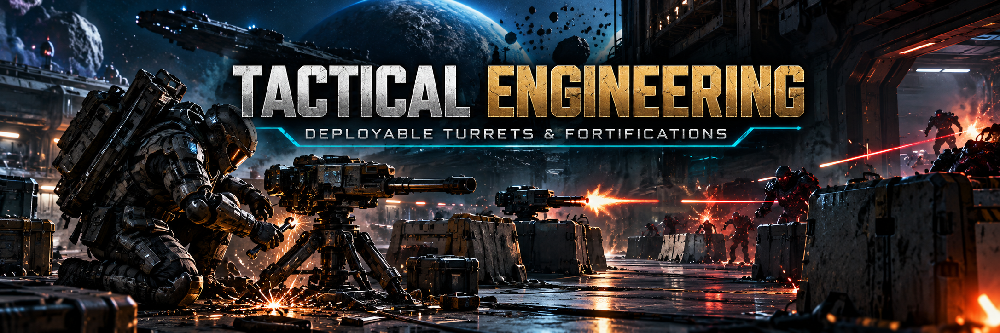

# Tactical Engineering — realistic deployable turrets for SpaceBourne 2

The turret perk stops being an instant MMO spawn and becomes real engineering. You carry one heavy
turret, kneel to set it up and to pack it up, and lose it if you leave it behind. Once it is
deployed it does the job, and the enemy treats it as a threat: they shoot back until it breaks.
The barricade perk gets the same treatment, and higher perk levels make you a better engineer.
It uses the game's own perk buttons: no extra keys.

Version 0.2.3 · [Nexus Mods page](https://www.nexusmods.com/spacebourne2/mods/10) · UE4SS Lua mod ·
works alone or with [Hardcore Tactical Realism](https://github.com/hubertdungen/SpaceBourne2-HardcoreTacticalRealism).

## What it does

- **Deploying takes time.** Press your **turret perk button**: you kneel and can't move for 6
  seconds, then the turret stands 2 m in front of you, unfolds and opens fire. While you work, you
  are exposed.
- **It stays.** No 25–40 second lifetime and no self-destruct. It keeps firing until you pack it
  up, it is destroyed, or you leave it behind.
- **Packing up takes time too.** Press the turret perk button next to it: it stops firing at once,
  and you kneel for 5 seconds.
- **One turret, and it is heavy.** Packed, you carry it: you walk at 80 % speed and can't sprint.
  Damage stays with the turret.
- **Leave it behind and it is gone.** A turret still deployed when you leave the area is lost. So
  is a destroyed one. A replacement waits for you at your ship or a station, out of combat, 5
  minutes after the loss.
- **Smaller, not weaker.** It is 60 % the size of the vanilla perk turret, with the same belt-fed
  gun: 10 rounds/s at enemies within 100 m in line of sight, 3–5 s reloads between belts.
- **Limited ammo.** It carries 300 rounds. The ammo stays with it when you pack it up, and it is
  refilled from your ship: in space or on a station, out of combat, while you carry the turret.
  Empty, it stops firing.
- **It makes noise.** Setting it up or packing it up (a barricade too) is metal work that enemies
  within about 15 m hear. A firing turret is heard about 60 m away. Unaware enemies go on high
  alert and come to search around the noise for up to 12 seconds; once alert, HTR's longer alert
  sight range applies. With [Silent Ops](https://github.com/hubertdungen/SpaceBourne2-SilentOps)
  0.2 or later, Silent Ops handles the noise instead, with its own suspicion → search → alert:
  never both.
- **It can be destroyed.** Rifle hits chip it, snipers and heavy weapons hurt, explosions wreck
  it. A destroyed turret stays as a dead wreck.
- **Enemies fight back.** Enemies hit by a turret, or near one that is firing, turn and shoot it:
  up to 3 at a time, for a few seconds, then they choose again between you and the turret.
- **Barricades.** The barricade perk's energy-shield wall is no longer instant and
  short-lived. Press the barricade perk button: you kneel for 4 seconds, and the wall stays until
  you pack it up (3 seconds, next to it) or leave the area. You carry 1 (2 at perk level 2, 3 at
  level 3), restocked at your ship. It stops enemy rounds, which wear it down until it collapses.
  Building is noisy, like the turret.
- **Perk levels matter.** Each level of the turret or barricade perk above 1 sets up
  15 % faster and adds 20 % structure; each turret level also adds 100 rounds (300 / 400 / 500).
  Small steps, no MMO scaling.
- **Ally engineers (on by default).** Squad soldiers, including the game's unused "Turretci" role,
  and companions can stop in a fight and deploy a turret of their own (at most 2 per area). Tap a
  perk button 4 times quickly to switch them off or on.
- **On by default.** Installed, it is on. Tap the turret or barricade perk button 3 times quickly to
  switch it off (the vanilla perks come back) or on again.

## Requirements

- SpaceBourne 2 (Steam).
- [UE4SS 3.0.1](https://github.com/UE4SS-RE/RE-UE4SS/releases/tag/v3.0.1). Installing HTR
  installs it too.
- **The game's perks.** The turret needs the turret perk, barricades need the barricade perk:
  learned and in an action slot, as in vanilla. Before you learn a perk, you don't have that
  equipment (no carry weight either); pressing for it shows "Requires the Turret perk" /
  "Requires the Barricade perk". Higher perk levels give the bonuses above.
- Recommended: [Hardcore Tactical Realism](https://github.com/hubertdungen/SpaceBourne2-HardcoreTacticalRealism)
  0.4.2 or later; 0.4.8 or later gives the turret its own light caliber. HTR handles the
  ballistics of the turret's rounds and of the rounds fired at it.
  Tactical Engineering costs no suit energy and leaves other perks' cooldowns alone, so HTR's slower
  perk recharge applies unchanged.

## Install

1. Download `TacticalEngineering-0.2.3.zip` from the
   [releases](https://github.com/hubertdungen/SpaceBourne2-TacticalEngineering/releases).
2. Extract it into the game folder (`...\steamapps\common\SpaceBourne 2\`). It adds
   `SB2\Binaries\Win64\Mods\TacticalEngineering\`; the `enabled.txt` inside turns it on.
3. That's it: Tactical Engineering is on in game. To switch it off, tap the turret or barricade
   perk button 3 times quickly (remembered between sessions). `StartOn = false` in
   `scripts\config.lua` makes a fresh install start off.

Manual install: copy the `TacticalEngineering` folder from this repository into
`SpaceBourne 2\SB2\Binaries\Win64\Mods\`.

Uninstall: delete `SB2\Binaries\Win64\Mods\TacticalEngineering`. Tactical Engineering never writes
to your saves. It keeps its own state (on/off, your turret) in `te_state.txt` in its folder.

## Controls (on foot)

The game's own perk buttons, in whatever action slot you put the perks. No new keys.

| Input | What it does |
|---|---|
| **Turret perk button** | Carrying: deploy. Next to your turret: pack it up. While working: cancel. |
| **Barricade perk button** | Build a barricade. Next to one of yours: pack it up. While working: cancel. |
| Either one, **3 quick taps** | Switches the **whole mod** on / off (on by default). While it is off, the first taps are still the vanilla perk. |
| Either one, **4 quick taps** | Switches the **ally engineers** on / off (on by default). The HUD says "Ally engineers ON" / "OFF". |

Each press shows one short message on the HUD, without the game's "tu-tu-tu" alarm. Like HTR,
Tactical Engineering mutes that one sound for 2 seconds around its own messages. There is no
countdown, and damage to your turret is reported only at 75, 50 and 25 %.

**Optional extra key:** `DeployKey` in `scripts\config.lua` (none by default; 0.1 used Delete).
A tap acts like the turret perk button (the turret perk is still needed); holding it 2 s switches
the whole mod on / off. The plain key does nothing while Shift, Ctrl or Alt is held, so
**Shift+Delete** stays free for Gear Without Levels; the game's own keys (F1–F6, F8, F10, F11, F12)
are refused without a modifier.

While Tactical Engineering is on, the vanilla instant turret and barricade perks are switched off:
their icons show as cooling down. Switch Tactical Engineering off, and they work as before.

### Ally engineers

- **Who:** soldiers of your ground squad (the ones you order with F1 / F2 / F5 on foot: fire at
  will, cover, get out) and your companions. Each one is picked at random the first time Tactical
  Engineering sees it in a session: about 1 squad soldier in 10 and 1 companion in 7 is an engineer.
  The game also has a "Turretci" (turret operator) squad role, but its squad never uses it; if a
  game update ever does, those soldiers are always engineers.
- **How to get them:** there is no special hire. Get a squad or a companion the way the game gives
  them; Tactical Engineering doesn't change that. The exact recruiting menus are not confirmed here.
- **What they do:** in a fight, an engineer stops for 8 seconds and sets up its own turret where it
  stands. At most 2 ally turrets per area; they stay until you leave it.
- **Tip:** a bigger squad means more chances of an engineer. 4 quick perk-button taps switch them
  off or on.

## Settings

Edit `Mods\TacticalEngineering\scripts\config.lua`. Every line is optional. The main ones:

- `Player`:
  - `DeploySeconds` / `PackSeconds` (6 / 5);
  - `PackRange`;
  - `CarrySpeed` (0.8) and `CarryNoSprint`;
  - `Resupply`: `"ship"`, `"level"` or `"never"`, and `ResupplyMinutes`.
- `Turret`:
  - `Scale` (0.6);
  - `Structure` (100) and `HitCost` per attacker type;
  - `DestroyedEffect`: `"wreck"`, or `"explode"` (the vanilla blast);
  - `Rounds` (300): 0 = unlimited.
- `Levels` (per perk level above 1): `SetupFaster` (15 %), `ExtraRounds` (100),
  `ExtraStructure` (20 %).
- `Barricades`: `Enabled`, `BuildSeconds` / `PackSeconds` (4 / 3), `PackRange`, `Carried` (1) +
  `ExtraPerLevel` (1), `Structure` (150).
- `Noise`:
  - `WorkRadius` (15 m) and `FireRadius` (60 m);
  - `AlertEnemies`;
  - `Search`, `SearchRadius` (4 m around the noise) and `SearchSeconds` (12).

  The noise events are also shared with other mods (for Silent Ops) through the UE4SS shared
  variable `SB2R_Noise`.
- `Enemies`:
  - whether enemies attack turrets;
  - how far a firing turret is noticed;
  - the chance per second;
  - at most how many at once, and for how long.
- `Allies`:
  - `Engineers`: the starting state (on); 4 quick taps switch them in game;
  - chances for squad soldiers and companions;
  - `MaxAllyTurrets` per level.

## Known limits

- **NPCs don't take cover behind barricades.** The game's AI has no cover search to use them. The
  wall still stops rounds for anyone standing behind it.
- **Only enemy rounds wear barricades down.** Grenades and other blasts don't damage them.
- **With Silent Ops, work noise is mild for now.** Silent Ops hears a turret being set up (12 m),
  packed and firing, but one setup or pack only adds a little suspicion, and it doesn't read
  barricade work yet. Tuning that is on the Silent Ops side.
- **No new animations.** Kneeling is the normal crouch, and the turret uses the vanilla perk's
  unfold animation. The packed turret isn't visible on your back.
- **Enemies notice it, they don't see it.** The game's enemies only "see" people. They turn on a
  turret once it shoots them or fires near them, not by spotting a silent one.
- **Short hitches.** The first deploy of a session, the first enemy that turns on a turret, and
  packing up a barricade can each cost one frame of about 50 ms.
- **The state is not per save.** It is per game install: loading an older save keeps your current
  turret state.

<!-- nexus:skip -->
## Test status

0.2.2 tested in game on 2026-11-06, with HTR 0.4.12:
- pack and redeploy keep the turret's rounds and damage ("carrying it (394 rounds)", then
  "deployed - 394 rounds");
- a turret cut off mid-burst is recovered after 3 s with its rounds; 40 m away it is lost and removed;
- a perk turret the mod doesn't know is silenced, then recovered by a press next to it (or removed if
  you carry your own);
- an empty turret switches off, with no muzzle flash or tracer.

0.2.1 tested in game on 2026-10-31, with HTR 0.4.8:
- 4 quick perk-button taps switching the ally engineers off and on, 3 taps the whole mod;
- two squad soldiers deploying their turrets in a fight (the cap is 2).

0.2 tested in game on 2026-10-31, with HTR 0.4.8:
- the barricade perk call: no vanilla wall, no energy spent; a 3.4 s build at perk level 2, no
  lifetime limit;
- enemy rounds stopped by the wall and wearing it down; the collapse; packing it up;
- turret perk level 3: a 4.2 s deploy and 500 rounds;
- the turret at 60 %: rounds leave from its muzzle (the muzzle point scales with it: 96 cm from the
  base vs 160 cm at full size), its base stays on the ground, and enemy rounds still hit it;
- only the perk buttons; 3 taps on the barricade button switch the mod off and on, and the vanilla
  barricade works again while it is off; "Requires the Turret / Barricade perk" without them;
- the deploy noise heard by an unaware enemy 12–14 m behind: alert, it walks toward the noise,
  looks around, and goes back to its routine 12 s later;
- with Silent Ops (current build): Tactical Engineering stays out, and Silent Ops hears the
  packing ("heard turret pack at 6 m").

Tested in game on 2026-10-31, with HTR 0.4.7:
- limited ammo running out, then the refill at the ship;
- the noise of a deploy heard by an unaware enemy behind you, and of a firing turret;
- the noise shared as `SB2R_Noise`;
- the muted alarm;
- the damage notices at thresholds;
- the 3-tap toggle.

Tested in game on 2026-10-30, with HTR 0.4.5:
- on/off with the real key (hold), deploy and pack with real key taps, the perk button;
- kneeling and the movement lock, the carry slowdown and no sprint;
- the turret's lifetime, scale and placement;
- enemies killed by the turret;
- enemies turning on the turret and their rounds damaging it, down to a wreck;
- a turret left behind when the level changes;
- Shift+Delete staying quiet;
- frame times (see DESIGN.md, section 13).

Not tested yet:
- companions as engineers;
- the optional rare enemy engineers (vanilla mini-turrets);
- allies destroying an enemy mini-turret;
- the replacement after 5 minutes at a real ship or station on a planet run;
- the turret's own ballistics in HTR 0.4.8 (`turret_light`), and Silent Ops 0.2 hearing the turret.

Design notes, research and the full test log: [DESIGN.md](DESIGN.md).
<!-- /nexus:skip -->

## Part of the SpaceBourne 2 realism set

Separate mods that work alone or together. To install them all at once, use the installer:
[SpaceBourne 2 Realism](https://github.com/hubertdungen/SpaceBourne2-Realism)
([Nexus](https://www.nexusmods.com/spacebourne2/mods/11)).

| Mod | Status |
|---|---|
| **Hardcore Tactical Realism (HTR)** — realistic ballistics and tactical AI | released: [GitHub](https://github.com/hubertdungen/SpaceBourne2-HardcoreTacticalRealism) · [Nexus Mods](https://www.nexusmods.com/spacebourne2/mods/4) · [Steam discussion](https://steamcommunity.com/app/1646850/discussions/0/573805072991123580) |
| **Silent Ops** — realistic stealth | released: [GitHub](https://github.com/hubertdungen/SpaceBourne2-SilentOps) · [Nexus Mods](https://www.nexusmods.com/spacebourne2/mods/6) |
| **Split Controls** — separate invert for ship and on foot | released: [GitHub](https://github.com/hubertdungen/SpaceBourne2-SplitControls) · [Nexus Mods](https://www.nexusmods.com/spacebourne2/mods/5) |
| **Gear Without Levels** — use gear regardless of level | released: [GitHub](https://github.com/hubertdungen/SpaceBourne2-GearWithoutLevels) · [Nexus Mods](https://www.nexusmods.com/spacebourne2/mods/7) |
| **Tactical Engineering** — deployable turrets (this mod) | released: [GitHub](https://github.com/hubertdungen/SpaceBourne2-TacticalEngineering) · [Nexus Mods](https://www.nexusmods.com/spacebourne2/mods/10) |
| Faction Power | coming |
| Tactical First Person | coming |

## Thanks

TheCalcMan (Steam), for play-testing the realism set and for the ammo-limit idea.

## License

MIT. See [LICENSE](LICENSE).
